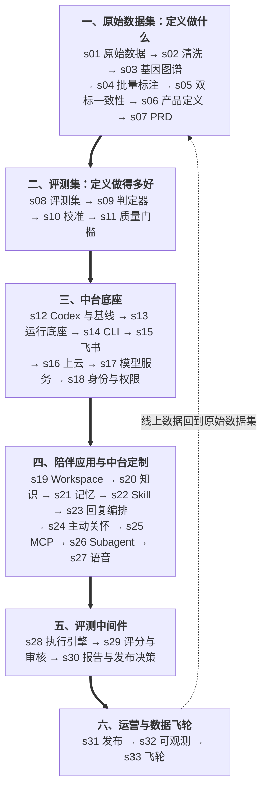

# Agentic 产品课 —— 用两个数据集定义一个产品

## 产品从哪来，质量由谁说了算

在写第一行 Agent 代码之前，先把一件事说清楚。

**一个 Agentic 产品，由两个数据集定义。**

- **原始数据集定义"做什么"。** 用户已经在应用商店、社区和反馈里写下了他们要什么、在哪里卡住、希望 AI 怎样回应。把这些声音收集起来，按一套维度打上标签，标签的分布会告诉你：为谁做、解决什么、做到哪里为止。
- **评测集定义"做得多好"。** 输入是什么、期望怎样、怎么判定——这一整套对输入和输出的评估，就是产品质量的定义。产品好不好，不是看演示，而是看它在评测集上的表现。

```
                     两个数据集定义一个产品
                     ======================

   用户声音 ──抓取──▶ 原始数据集 ──打标──▶ 产品定义
                                              │
                                        抽样与扩展
                                              ▼
                                           评测集 ──▶ 构建：让用例一个个通过
                                              ▲                  │
                                              │                发布
                        坏样本与新声音 ◀──────┴──── 线上反馈 ◀───┘

   原始数据集回答"做什么"，评测集回答"做得多好"。
   代码只是让评测集里的用例一个个通过。
```

### 为什么不是先写功能

Agent 能做的事越来越多，"能不能做出来"不再是难点。真正的难点变成了两个问题：**做的是不是用户要的**，以及**做出来的东西到底好不好**。

先拍脑袋列功能，再找人试用，你会在第三周才发现用户在意的根本不是那个功能；先写代码再补测试，你会发现"变好了"只是演示时恰好答对。两个数据集把这两个问题前置：

- 产品定义里的每一句，都能指回原始数据里的样本与标签；
- 评测集先于代码。先用评测集跑一遍裸模型，得到基线；之后每一章的构建，都以"让哪些用例通过"为目标；
- 两个数据集一起生长：线上数据回到原始数据集重新打标，新发现的问题扩充评测集。

### 贯穿全书的项目

一家做 AI 陪伴产品的公司，手里有一个通用的企业 AI 中台。**具体做什么样的陪伴产品，不预设。** 第一部分从应用商店里抓下用户的公开评论，打上标签，画出机会地图，再让数据决定：为谁做、解决哪一个痛点、做到哪里为止。产品定下来之后，每一项中台能力都分两层讲：通用中台提供什么，这个产品要求它做什么定制。

```
陪伴 Agent = 模型（Kimi）
          + Harness（Codex）
          + 产品定义决定的能力（第一部分得出）
          + 中台（运行底座、模型服务、身份权限、评测与可观测、发布）
```

---

**33 个递进式课程，从一条用户评论到持续变好的产品。**
**每个课程加一个机制，每个机制一句格言。**

> **s01** &nbsp; *"先听用户说，再想做什么"* &mdash; 产品定义从原始数据开始，而不是从会议室开始
>
> **s02** &nbsp; *"脏数据标得再准也是脏的"* &mdash; 去重、去标识、标出信息量不足的样本
>
> **s03** &nbsp; *"标签决定你能看见什么"* &mdash; 维度从数据里长出来，规则写到能被两个人标成一样
>
> **s04** &nbsp; *"判断交给模型，规则留在文件里"* &mdash; 规范、分块、校验，模型逐条读，脚本只管搬运
>
> **s05** &nbsp; *"一致性不够，就改规则，不改分数"* &mdash; 用 κ 找出说不清的基因，改规范、只重标、人工裁决
>
> **s06** &nbsp; *"定义里的每一句都能指回样本"* &mdash; 分布、切片、机会地图 → 产品假设 → 产品定义
>
> **s07** &nbsp; *"写到别人能照着做、照着测"* &mdash; 业务标准与 PRD
>
> **s08** &nbsp; *"先有考卷，再有学生"* &mdash; 从行为主题生成评测集
>
> **s09** &nbsp; *"判分的人也要被检查"* &mdash; 规则、模型评判与人工三类判定器
>
> **s10** &nbsp; *"评委先对齐，分数才可信"* &mdash; 人人、人机、抽样校准
>
> **s11** &nbsp; *"关键用例一条不过，就不发布"* &mdash; 能力集、回归集与发布门禁
>
> **s12** &nbsp; *"先量一次裸模型"* &mdash; Codex 接 Kimi，用评测集跑出基线
>
> **s13 – s18** &nbsp; 中台底座 &mdash; 运行底座、CLI、飞书、上云、模型服务、身份与权限
>
> **s19 – s27** &nbsp; 陪伴应用与中台定制 &mdash; Workspace、知识、记忆、Skill、回复编排、主动关怀、MCP、Subagent、语音
>
> **s28 – s30** &nbsp; 评测中间件 &mdash; 执行引擎、评分与审核、报告与发布决策
>
> **s31 – s33** &nbsp; 运营与数据飞轮 &mdash; 发布与灰度、可观测、两个数据集一起长大

---

## 核心模式

```python
raw = crawl(public_reviews)                  # s01：用户已经写下的声音
raw = clean(raw)                             # s02：去重、去标识
labels = annotate(raw, genome)               # s03–s05：按基因图谱打标，并证明标注可信
definition = define(opportunities(labels))   # s06：机会地图 → 产品假设 → 产品定义
eval_set = cases_from(definition, labels)    # s08：先有考卷

while not passes(product, eval_set):         # s12 起：每一章让更多用例通过
    product = build_next_mechanism(product)
```

每一章都在这个循环上加一个机制。原始数据集回答"做什么"，评测集回答"做得多好"，代码只是让用例一个个通过。

## 课程边界

这门课讲怎样把一个 Agentic 产品从想法做到生产，并持续变好。它**不覆盖合规**，也不讨论定价、广告与会员等商业运营问题。示例数据来自公开的应用商店评论，数据本身不进仓库，读者自己运行脚本抓取。

## 快速开始

```sh
git clone https://github.com/pengcong2020520/agentic-product-course
cd agentic-product-course
pip install -r requirements.txt

python s01_raw_data/code.py                          # 抓取公开评论 → data/raw/
python s02_clean/code.py                             # 清洗与去标识 → data/clean/
python s03_product_genome/code.py list               # 看一看基因图谱
python s04_labeling/code.py run data/double codex 5 --dry-run   # 标注命令预览
python -m pytest tests -q                            # 全书测试
```

标注用本机已登录的 Codex CLI 与 Grok CLI；人工裁决用本地 Argilla（见 s05）。

## 学习路径



## 全部章节

| 章节 | 主题 | 关键概念 |
|---|---|---|
| [s01](./s01_raw_data/) | 原始数据 | 公开评论 RSS / 不存昵称 / 可重复抓取 |
| [s02](./s02_clean/) | 清洗与去标识 | NFKC / 占位符去标识 / 近似去重 / `low_info` |
| [s03](./s03_product_genome/) | Agentic 产品基因图谱 | 人·事·解 / 十八个基因 / 一级与二级触点 / 判定规则 |
| [s04](./s04_labeling/) | 批量标注 | brief / 分块 / Codex 与 Grok CLI / 自检 OK / 断点续跑 |
| [s05](./s05_agreement/) | 双标一致性 | κ / 单基因重标 / 关键分歧裁决 / 质量报告 |
| [s06](./s06_product_definition/) | 从标签到产品定义 | 分布 / 人群切片 / 行为主题 / 机会地图 / 产品假设 |
| s07 – s33 | 编写中 | 见上方格言清单与学习路径 |

---

## 如何阅读

每一章都是一个文件夹。打开后你会看到：

```
s05_agreement/
  README.md          # 正文：问题 → 解决方案 → 工作原理 → 试一下 → 接下来
  code.py            # 本章独立可运行的实现（子命令见文件顶部 Usage）
  images/            # SVG 图示
  protocol.md        # 本章资产（不同章节不同）
```

先读 `README.md` 理解问题与机制，再对照 `code.py` 跑一遍。复杂章节用 `<details>` 折叠深入内容，想深入时再展开。按顺序从 s01 读起：后一章的输入，就是前一章的输出。

## 项目结构

```
agentic-product-course/
  s01_raw_data/              # 每章一个文件夹
  s02_clean/
  s03_product_genome/        #   genome.json + genome.md：基因图谱
  s04_labeling/              #   brief.md：给标注 Agent 的任务说明
  s05_agreement/             #   protocol.md：标注与裁决规则
  s06_product_definition/    #   机会地图与产品定义
  tests/                     # 全书测试（pytest）
  docs/                      # 调研与规划
  data/                      # 运行产物（不进仓库）
  requirements.txt
  .env.example
```

## 学完之后

你会得到的不只是一个陪伴 Agent，而是一套可复用的做法：任何领域的 Agentic 产品，都可以先建原始数据集回答"做什么"，再建评测集回答"做得多好"，然后让每一次构建、每一次发布都由这两个数据集说了算。

## 许可证

MIT

---

**原始数据集定义做什么，评测集定义做得多好。代码只是让用例一个个通过。**
