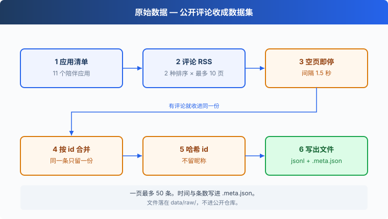

# s01: 原始数据 — 让用户自己告诉你要做什么

`s01` → [s02](../s02_clean/) → s03 → s04 → s05 → s06
> *"先听用户说，再想做什么"* — 产品定义从原始数据开始，而不是从会议室开始。
>
> **方法层**：原始数据集 v0：可重复抓取的公开用户声音

---

## 问题

你要做一款 AI 陪伴产品，名字叫「独一无二的 TA」。团队里每个人都有一套「用户要什么」的说法，会议室里对不齐。

用户其实已经写过了。应用商店里的公开评论，就是他们用完之后留下的话：哪里好，哪里让人生气，还想要什么。

这一章把这些公开评论抓下来，收成一份谁都能再跑一遍的原始数据集。

---

## 解决方案



走 Apple 公开的评论 RSS，中国区。`s01_raw_data/apps.json` 里是 11 个陪伴类应用。每个应用两种排序，`mostrecent` 和 `mosthelpful`，每种排序最多 10 页，一页最多 50 条。每次请求间隔 1.5 秒。

| 信号 | 含义 | 动作 |
|------|------|------|
| 两种排序都抓到同一条 | 同一条评论出现了两次 | 按评论 id 合并，只留一份 |
| 这一页没有评论 | 这个排序已经翻完 | 停止，不再往下翻 |
| 写出一行 | 给数据集用的 id | 做哈希，不写昵称 |
| 抓取结束 | 需要能再跑一次对照 | 旁边写 `.meta.json`，记下时间和条数 |

社区帖子看起来更密。多数平台的条款限制抓取，Reddit 还要登录。公开 RSS 不需要账号，所以这一章只走 RSS。

抓下来的文件不进公开仓库。脚本写到 `data/raw/`，你在自己的机器上跑。

按这张清单抓到的参考结果是 5,522 条：1 星 1,400，5 星 2,599，字数中位数 34。商店每天都在变。你再跑一次，条数以你这份 `.meta.json` 里的 `total` 为准。

---

## 工作原理

脚本做三件事：按页去拉，把同一条评论收成一行，再把时间和条数记在旁边。

**第 1 步**：先定抓取的边界。地址、两种排序、最多翻几页、两页之间停多久。

```python
FEED = "https://itunes.apple.com/cn/rss/customerreviews/page={page}/id={app_id}/sortby={sort}/json"
SORTS = ("mostrecent", "mosthelpful")
MAX_PAGES = 10
DELAY_SECONDS = 1.5
UA = "agentic-product-course/0.1 (course research)"
```

**第 2 步**：请求失败就隔一会儿再试。三次都不行，放弃这一页，继续后面的。

```python
def fetch(url, retries=3):
    for attempt in range(retries):
        try:
            req = urllib.request.Request(url, headers={"User-Agent": UA})
            with urllib.request.urlopen(req, timeout=20) as resp:
                return json.load(resp)
        except (urllib.error.URLError, TimeoutError, json.JSONDecodeError) as exc:
            if attempt == retries - 1:
                print(f"  放弃 {url}: {exc}")
                return None
            time.sleep(DELAY_SECONDS * (attempt + 2))
```

**第 3 步**：每个应用、每种排序，从第 1 页翻到第 10 页。这一页没有带评分的评论，就停止这个排序。

```python
def crawl_app(app):
    seen = {}
    for sort in SORTS:
        for page in range(1, MAX_PAGES + 1):
            data = fetch(FEED.format(page=page, app_id=app["id"], sort=sort))
            entries = (data or {}).get("feed", {}).get("entry", [])
            if isinstance(entries, dict):
                entries = [entries]
            entries = [e for e in entries if "im:rating" in e]
            if not entries:
                break
```

接口有时把唯一一条评论放成一个对象，而不是数组。这里先收成列表，再只留下带 `im:rating` 的条目。

**第 4 步**：用商店里的评论 id 做键。两种排序抓到同一条，后一次覆盖前一次，只留一份。写进数据集的 `id` 是另一回事：应用 id 和评论 id 拼起来做 sha1，取前 12 位，前面加上 `as-`。字段里有评分、标题、正文、版本和日期，没有昵称。抓完一页停 1.5 秒。

```python
            for e in entries:
                rid = e["id"]["label"]
                seen[rid] = {
                    "id": "as-" + hashlib.sha1(f"{app['id']}:{rid}".encode()).hexdigest()[:12],
                    "source": "appstore-cn",
                    "app": app["name"],
                    "app_id": app["id"],
                    "rating": int(e["im:rating"]["label"]),
                    "title": e["title"]["label"],
                    "content": e["content"]["label"],
                    "version": e.get("im:version", {}).get("label"),
                    "date": e["updated"]["label"],
                }
            time.sleep(DELAY_SECONDS)
    return list(seen.values())
```

**第 5 步**：读入应用清单，按应用把行写成 jsonl。全部写完，在同名的 `.meta.json` 里记下 `crawled_at`、`total` 和这次用的应用清单。`appstore_reviews.jsonl` 旁边就是 `appstore_reviews.meta.json`。

```python
    apps = json.loads(Path(args.apps).read_text(encoding="utf-8"))
    out = Path(args.out)
    out.parent.mkdir(parents=True, exist_ok=True)
    total = 0
    with out.open("w", encoding="utf-8") as f:
        for app in apps:
            rows = crawl_app(app)
            for r in rows:
                f.write(json.dumps(r, ensure_ascii=False) + "\n")
            total += len(rows)
            print(f"{app['name']}: {len(rows)} 条")
    meta = {"crawled_at": datetime.now(timezone.utc).isoformat(), "total": total, "apps": apps}
    out.with_suffix(".meta.json").write_text(json.dumps(meta, ensure_ascii=False, indent=2), encoding="utf-8")
    print(f"共 {total} 条 → {out}")
```

**串起来**：第 3 步和第 4 步合在一起，就是 `crawl_app`。同一个 `seen` 贯穿两种排序，所以重叠在写文件之前已经收掉了。

```python
def crawl_app(app):
    seen = {}
    for sort in SORTS:
        for page in range(1, MAX_PAGES + 1):
            data = fetch(FEED.format(page=page, app_id=app["id"], sort=sort))
            entries = (data or {}).get("feed", {}).get("entry", [])
            if isinstance(entries, dict):
                entries = [entries]
            entries = [e for e in entries if "im:rating" in e]
            if not entries:
                break
            for e in entries:
                rid = e["id"]["label"]
                seen[rid] = {
                    "id": "as-" + hashlib.sha1(f"{app['id']}:{rid}".encode()).hexdigest()[:12],
                    "source": "appstore-cn",
                    "app": app["name"],
                    "app_id": app["id"],
                    "rating": int(e["im:rating"]["label"]),
                    "title": e["title"]["label"],
                    "content": e["content"]["label"],
                    "version": e.get("im:version", {}).get("label"),
                    "date": e["updated"]["label"],
                }
            time.sleep(DELAY_SECONDS)
    return list(seen.values())
```

<details>
<summary>边界与参数</summary>

默认参数：

```python
def main():
    ap = argparse.ArgumentParser()
    ap.add_argument("--apps", default="s01_raw_data/apps.json")
    ap.add_argument("--out", default="data/raw/appstore_reviews.jsonl")
    args = ap.parse_args()
```

- 应用名单和商店 id 在 `s01_raw_data/apps.json`：星野、猫箱、筑梦岛、MoMood、心屿、模拟女友、Tavo、talkmaker、虚拟男友、AI极昼、豆包。
- 单次请求超时 20 秒。失败时按 `DELAY_SECONDS * (attempt + 2)` 等待后再试，第三次仍失败就放弃该页，打印原因，返回空。
- 空页在等待之前就 `break`，这个排序不再多停 1.5 秒。重试的等待发生在 `fetch` 里面。
- 脚本不自己把一页截成 50 条。50 是这条 RSS 一页的上限，页里带评分的条目都会留下。
- 合并用的键是商店评论 id。写进文件的 `id` 是哈希。两个字段不是同一个字符串。
- 输出目录不存在时会先建好。再次运行会覆盖同一个 `--out`。

</details>

---

## 试一下

**准备**（在仓库根目录）：

```sh
pip install -r requirements.txt
```

这一章不读 `.env`。接口是公开的，运行时要能访问网络。11 个应用、每页间隔 1.5 秒，完整跑一遍会花一会儿。

**运行**：

```sh
python s01_raw_data/code.py --apps s01_raw_data/apps.json --out data/raw/appstore_reviews.jsonl
```

可以试这三件事：

1. 跑上面的默认命令。终端里每个应用一行条数，最后一行是合计。
2. 把 `--out` 换成 `data/raw/appstore_reviews_again.jsonl` 再跑一次。打开两份 `.meta.json`，对照 `crawled_at` 和 `total`。
3. 只抓清单里的第一个应用，看单应用的条数是否等于终端里那一行：

```sh
python - <<'PY'
import json
from pathlib import Path
apps = json.loads(Path("s01_raw_data/apps.json").read_text(encoding="utf-8"))
Path("data/raw").mkdir(parents=True, exist_ok=True)
Path("data/raw/one_app.json").write_text(
    json.dumps(apps[:1], ensure_ascii=False, indent=2), encoding="utf-8"
)
PY
python s01_raw_data/code.py --apps data/raw/one_app.json --out data/raw/one_app_reviews.jsonl
```

**观察重点**：`.meta.json` 里的抓取时间与条数，不同排序抓到的重叠有多少。重叠不会单独落盘：两种排序共用一个 `seen`，同一条只留一份，`total` 是合并之后的数。

---

## 接下来

这份 jsonl 还不能直接拿去标。同一句话可能留下两次，只有「好玩」两个字的评论也在里面，正文里还可能夹着手机号和微信号。

s02 清洗与去标识 → 抓到的数据能直接标吗？
