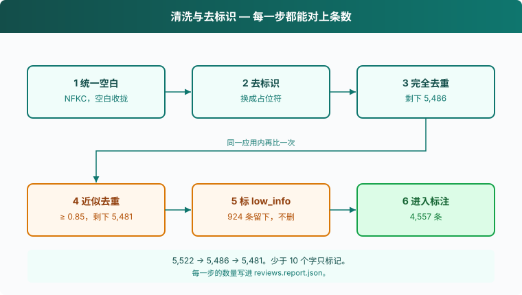

# s02: 清洗与去标识 — 把噪声和隐私挡在标注之前

s01 → `s02` → [s03](../s03_product_genome/) → s04 → s05 → s06
> *"脏数据标得再准也是脏的"* — 去重、去标识、标出信息量不足的样本。
>
> **方法层**：原始数据集 v1：每一步都有数量可追溯

---

## 问题

s01 抓到 5,522 条。直接拿去标注，会碰上三件事。

有的评论文字相同，有的只差一两个字，刷屏会把同一个声音算很多遍。有的评论只有「好玩」两个字，标不出谁、在什么处境、希望 AI 怎样做。还有的正文里夹着手机号、微信号、邮箱。

这些噪声和联系方式一旦进了标注，后面的基因分布会跟着歪。这一章在标注之前把它们处理掉，并且让每一步剩下多少条都能对上。

---

## 解决方案



顺序是固定的：统一空白（NFKC）→ 去标识 → 完全去重 → 同一应用内用 3 字片段做 Jaccard，相似度达到 0.85 就当成近似重复 → 少于 10 个字的标成 `low_info`。

`low_info` 不删除。样本留在文件里，只是不进入标注。删掉的话，从 5,522 到 4,557 中间那几步对不上。

| 步骤 | 动作 | 数量 |
|------|------|------|
| 输入 | s01 写出的 jsonl | 5,522 |
| 完全去重 | 去掉标点和符号后正文相同，只留先出现的一条 | 5,486 |
| 近似去重 | 同一应用内，3 字片段的 Jaccard ≥ 0.85 | 5,481 |
| 信息量不足 | 标 `low_info`，不标注 | 924 |
| 进入标注 | 其余样本 | 4,557 |

去标识把链接、邮箱、身份证号、手机号、账号换成占位符：`[链接]`、`[邮箱]`、`[身份证]`、`[手机号]`、`[账号]`。交给后面的是替换过的 `text`。

你自己的文件不一定是这几个数。课程这份数据走完是上面这张表；你跑完看 `reviews.report.json`。

---

## 工作原理

**第 1 步**：占位符和字数门槛写在一处。少于 10 个字只标记，不删。

```python
PII = [
    ("[链接]", re.compile(r"https?://\S+|www\.\S+")),
    ("[邮箱]", re.compile(r"[\w.+-]+@[\w-]+\.[\w.]+")),
    ("[身份证]", re.compile(r"(?<!\d)\d{17}[\dXx](?!\d)")),
    ("[手机号]", re.compile(r"(?<!\d)1[3-9]\d{9}(?!\d)")),
    ("[账号]", re.compile(r"(?i)(qq|微信|vx|wx|v信)\s*[:：号]?\s*[a-z0-9_-]{5,}")),
]
MIN_CHARS = 10  # 少于 10 个字的评论信息量不足，只计数不打标
```

**第 2 步**：统一空白。先做 NFKC，全角字母和数字折成半角；再把连续空白收成一个空格，换行也收进去。

```python
def normalize(text):
    text = unicodedata.normalize("NFKC", text)
    return re.sub(r"\s+", " ", text).strip()
```

全角数字先折成半角，后面的手机号正则才认得出。所以归一化在去标识之前。

**第 3 步**：按列表顺序替换五类联系方式，并记下每类替换了几次。

```python
def scrub(text, counter):
    for tag, pat in PII:
        text, n = pat.subn(tag, text)
        counter[tag] += n
    return text
```

**第 4 步**：标题和正文拼成一条 `text`，中间用句号隔开，然后先归一化、再去标识。后面的去重都看这条 `text`。

```python
    for r in rows:
        r["text"] = scrub(normalize(f"{r['title']}。{r['content']}"), pii)
    report["pii_replaced"] = dict(pii)
```

**第 5 步**：完全去重。去掉标点和符号之后如果相同，只保留先出现的那条。

```python
    exact, kept = set(), []
    for r in rows:
        key = re.sub(r"[\W_]+", "", r["text"])
        if key in exact:
            continue
        exact.add(key)
        kept.append(r)
    report["after_exact_dedup"] = len(kept)
```

**第 6 步**：切 3 字片段。正文去掉符号后不足 3 个字时，片段就是剩下的那一截，至少留一截。

```python
def shingles(text, k=3):
    t = re.sub(r"[\W_]+", "", text)
    return {t[i:i + k] for i in range(max(len(t) - k + 1, 1))}
```

**第 7 步**：只在同一个应用里两两比较。Jaccard 是交集大小除以并集大小，达到 `--near`（默认 0.85）就丢掉后一条。先出现的留下。

```python
    # 近似重复：同一应用内比较 3-gram 的 Jaccard 相似度（数据量小，直接两两比较）
    result, by_app = [], {}
    for r in kept:
        sig = shingles(r["text"])
        peers = by_app.setdefault(r["app"], [])
        if any(len(sig & s) / len(sig | s) >= args.near for s in peers):
            continue
        peers.append(sig)
        result.append(r)
    report["after_near_dedup"] = len(result)
```

**第 8 步**：`low_info` 只看原来的 `content`，去掉标点和符号之后的长度，标题不算。样本仍写进文件，`to_label` 把这些条数减掉。写出之前拿掉 `title` 和 `content`，未替换的原文不留第二份。报告打到终端，并写到输出文件旁边的 `.report.json`。默认就是 `data/clean/reviews.report.json`。

```python
    for r in result:
        r["low_info"] = len(re.sub(r"[\W_]+", "", r["content"])) < MIN_CHARS
        for k in ("title", "content"):
            r.pop(k)
    report["low_info"] = sum(r["low_info"] for r in result)
    report["to_label"] = len(result) - report["low_info"]

    out = Path(args.out)
    out.parent.mkdir(parents=True, exist_ok=True)
    with out.open("w", encoding="utf-8") as f:
        for r in result:
            f.write(json.dumps(r, ensure_ascii=False) + "\n")
    out.with_suffix(".report.json").write_text(json.dumps(report, ensure_ascii=False, indent=2), encoding="utf-8")
    print(json.dumps(report, ensure_ascii=False, indent=2))
```

报告里的键按这个顺序长出来：`input`、`pii_replaced`、`after_exact_dedup`、`after_near_dedup`、`low_info`、`to_label`。课程这份数据上，`input` 是 5,522，`after_exact_dedup` 是 5,486，`after_near_dedup` 是 5,481，`low_info` 是 924，`to_label` 是 4,557。

<details>
<summary>边界与参数</summary>

```python
def main():
    ap = argparse.ArgumentParser()
    ap.add_argument("--src", default="data/raw/appstore_reviews.jsonl")
    ap.add_argument("--out", default="data/clean/reviews.jsonl")
    ap.add_argument("--near", type=float, default=0.85, help="近似重复的 Jaccard 阈值")
    args = ap.parse_args()
```

- 字数用 `[\W_]` 去掉标点、符号和空白，汉字和数字留下。不足 10 个字看的是原始 `content`，发生在去标识之前。一条正文只有链接的短评，链接里的字符也计入。
- 标题进 `text`，参与去重和去标识，但不参与 `low_info`。正文是「好玩」、标题很长的样本，仍会标成信息量不足。
- 完全去重在近似去重之前。去掉符号后变成同一串的，先收成一条。
- 近似去重只比较同一个 `app`。两个应用里字面相同的评论都保留。
- 比较时后一条对照已经留下的片段集合，大于等于阈值就丢。阈值用的是 `--near`，默认 0.85。
- 五类正则按书写顺序替换。身份证在手机号之前，一串 18 位不会先被当成手机号切掉。账号要先出现 `qq`、`微信`、`vx`、`wx` 或 `v信`，后面再跟至少 5 位账号字符。
- 换 `--out` 时，报告文件名跟着变：`jsonl` 换成 `.report.json`。

</details>

---

## 试一下

**准备**（在仓库根目录）：

```sh
pip install -r requirements.txt
```

这一章不读 `.env`。输入是 s01 写出的 `data/raw/appstore_reviews.jsonl`。还没抓的话，先跑上一章。

**运行**：

```sh
python s02_clean/code.py --src data/raw/appstore_reviews.jsonl --out data/clean/reviews.jsonl
```

可以试这三件事：

1. 用默认的 `--near 0.85` 跑一遍。打开 `data/clean/reviews.report.json`，对着 `input`、`after_exact_dedup`、`after_near_dedup`、`low_info`、`to_label` 看。
2. 把阈值收到只剩片段完全相同才算重复，另写一个输出：

```sh
python s02_clean/code.py --src data/raw/appstore_reviews.jsonl --out data/clean/reviews-strict.jsonl --near 1
```

3. 把阈值放宽，看 `after_near_dedup` 怎么变：

```sh
python s02_clean/code.py --src data/raw/appstore_reviews.jsonl --out data/clean/reviews-loose.jsonl --near 0.5
```

**观察重点**：`reviews.report.json` 每一步的数量。`low_info` 仍然在 jsonl 里，`to_label` 才是下一章要标的条数。

---

## 接下来

噪声和联系方式挡住了，每条样本还是一整段话。只问「好评还是差评」，你得到一个平均分；只按功能分类，你看不到谁、在什么处境、希望 AI 怎样做。

s03 Agentic 产品基因图谱 → 按什么维度标？
