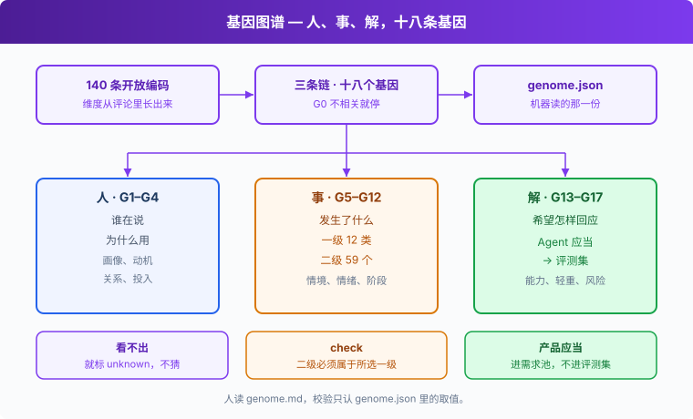

# s03: Agentic 产品基因图谱 — 给每条用户声音拆出基因

s01 → s02 → `s03` → [s04](../s04_labeling/) → s05 → s06
> *"标签决定你能看见什么"* — 维度从数据里长出来，规则写到能被两个人标成一样。
>
> **方法层**：基因图谱：人、事、解三条链十八个基因

---

## 问题

只问「好评还是差评」，你得到一个平均分。5,522 条里 5 星就有 2,599。平均分看不出谁在用、卡在什么处境、希望 AI 怎样做。

只按功能分类也一样。语音、记忆、收费会堆成几堆，堆里面的人并不相同。

这一章给每条用户声音拆基因。维度从评论里长出来，规则写到两个人能标成一样。

---

## 解决方案



先抽 140 条做开放编码。能反复看见的说法才留下，收成三条链。加上最先判断的 G0 相关性，一共十八个基因。G0 标成不相关，其余基因就停。

| 链 | 基因 | 在问什么 |
|----|------|----------|
| 人 | G1–G4 | 谁在说，为什么用 |
| 事 | G5–G12 | 发生了什么 |
| 解 | G13–G17 | 希望产品怎样回应 |

体验触点在「事」这一链里拆开：一级 12 类，二级 59 个。每个取值都有判定规则。看不出来就标 `unknown`，不猜。

人读的规范在 `genome.md`，机器读的同一份在 `genome.json`。校验只认 json 里的取值。这份规范是 v0.2.2。

G13 期望行为分两种写法。「Agent 应当……」进评测集，「产品应当……」进需求池。

---

## 工作原理

**第 1 步**：启动时读入仓库里的 `genome.json`。`list` 和 `check` 用的是同一份，路径相对仓库根，不写死本机目录。

```python
GENOME = json.loads((Path(__file__).resolve().parents[1] / "s03_product_genome/genome.json").read_text(encoding="utf-8"))
```

**第 2 步**：`check` 按基因表逐项看一条标注。不合规则的名字收进 `bad`。

```python
def check(raw, only=None):
    bad = []
    for g in GENOME["genes"]:
        if only and g["id"] not in only:
            continue
        v, t = raw.get(g["id"]), g["type"]
        if not only and raw.get("relevant") == "off_topic" and g["id"] != "relevant":
            continue
        if t in ("single", "rating"):
            ok = v in g["values"]
        elif t == "multi":
            ok = isinstance(v, list) and all(x in g["values"] for x in v) \
                 and bool(v or g.get("optional")) and len(v) <= g.get("max", 99)
            if ok and g.get("parent") and not only:
                ok = all(x.split(".")[0] in (raw.get(g["parent"]) or []) for x in v)
        else:
            ok = isinstance(v, str)
        if not ok:
            bad.append(f"{g['id']}={v!r}")
    return bad
```

`relevant` 为 `off_topic` 时，除了相关性本身，别的基因先跳过。一条不相关的评论可以只有这一个字段。

单选和评分必须落在合法值里。多选必须是数组，每一项都合法，而且不能为空——标了 `optional` 的可以空。有一个二级触点的前缀不在已选的一级里，整项就不通过。`memory.cross_session` 要求一级里有 `memory`；一级只选了别的，`check` 就拒绝。

自由文本只要是字符串。G13 走的就是这条。两种「应当」写进评测集还是需求池，规则在 `genome.md`，`check` 不替你分。

编号是 G0 到 G17，共十八个基因。G8 的情绪和强度在 `genome.json` 里分成两项，一个是单选，一个是 1、2、3 的评分，`list` 会各打一行。

**第 3 步**：对文件时，输出的 id 排序后必须和输入一致。多一条、少一条、对不上，都报「id 不对应」。对得上的每一行再交给 `check`。

```python
def check_file(src, out, only=None):
    ids = [json.loads(l)["id"] for l in open(src, encoding="utf-8")]
    rows = [json.loads(l) for l in open(out, encoding="utf-8") if l.strip()]
    errors = []
    if sorted(r.get("id") for r in rows) != sorted(ids):
        errors.append(f"id 不对应：输入 {len(ids)} 条，输出 {len(rows)} 条")
    for r in rows:
        bad = check(r, only)
        if bad:
            errors.append(f"{r.get('id')}: " + ", ".join(bad))
    return errors
```

行序可以不同。报错时带上这条样本的 id，后面是没通过的基因和它的取值。

**第 4 步**：`list` 逐个基因打印 id、标题、类型和取值。`check` 没有错误就打印 `OK` 并以 0 退出；有错误就打印错误并以 1 退出。

```python
    if args.command == "list":
        for gene in GENOME["genes"]:
            print(f"{gene['id']}\t{gene['title']}\t{gene['type']}")
            for value in gene.get("values", []):
                title = gene["values"][value] if isinstance(gene["values"], dict) else value
                print(f"  {value}: {title}")
    else:
        errors = check_file(args.src, args.out, set(args.only.split(",")) if args.only else None)
        print("OK" if not errors else "\n".join(errors[:30]))
        raise SystemExit(1 if errors else 0)
```

<details>
<summary>边界与参数</summary>

子命令：

```python
def main():
    parser = argparse.ArgumentParser(description=__doc__)
    commands = parser.add_subparsers(dest="command", required=True)
    checker = commands.add_parser("check", help="校验标注 id 与合法取值")
    checker.add_argument("src")
    checker.add_argument("out")
    checker.add_argument("only", nargs="?", help="只检查的基因，逗号分隔")
    commands.add_parser("list", help="打印基因 id、标题、类型与合法取值")
    args = parser.parse_args()
```

- `check` 的两个位置参数是输入 jsonl 和标注 jsonl。可选的第三个参数 `only` 用逗号分隔基因 id，只查这些基因。
- 一旦传了 `only`，`off_topic` 的跳过和「二级必须属于一级」都不再执行。想看父子关系被拒绝，就不要加第三个参数。
- 多选默认不能是空数组。`g6_subtouch` 和 `g17_risk` 在 `genome.json` 里标了 `optional`，空数组可以通过。一级触点的 `max` 当前是 3，代码里没写 `max` 的多选最多 99 项。
- 一级对不上表里的二级时，可以用该一级的 `.other`，只要这个值写在 `genome.json` 里，并且一级选了对应的前缀。
- `off_topic` 时其余基因写错了也不会被全量校验抓住，循环在检查取值之前就 `continue` 了。
- 错误最多打印 30 条。退出码仍是 1。
- 评分取值是整数 1、2、3。写成字符串过不了 `check`。

</details>

---

## 试一下

**准备**（在仓库根目录）：

```sh
pip install -r requirements.txt
```

这一章不读 `.env`。`list` 只读仓库里的 `genome.json`。`check` 下面用一份自己写的小样本，不需要上一章的评论文件。

**运行**：

```sh
python s03_product_genome/code.py list
```

再准备三份小文件：输入只有 id，一份标注合法，一份二级跑到了别的一级下面，一份只标了不相关。

```sh
python - <<'PY'
import json
from pathlib import Path
root = Path("data/genome-try")
root.mkdir(parents=True, exist_ok=True)
(root / "input.jsonl").write_text('{"id": "demo-1"}\n', encoding="utf-8")
ok = {
    "id": "demo-1",
    "relevant": "yes",
    "g1_user": ["confider"],
    "g2_motive": ["companionship"],
    "g3_relation": ["friend"],
    "g4_investment": "regular",
    "g5_touchpoint": ["memory"],
    "g6_subtouch": ["memory.cross_session"],
    "g7_trigger": ["daily"],
    "g8_emotion": "disappointed",
    "g8_intensity": 2,
    "g9_voice_type": "problem",
    "g10_stage": "ongoing",
    "g11_value": ["not_alone"],
    "g12_competitor": ["none"],
    "g13_expected": "Agent 应当记住上一轮。",
    "g14_capability": ["cap.memory"],
    "g15_solvable": "agent",
    "g16_severity": "p1",
    "g17_risk": [],
}
bad = dict(ok, g6_subtouch=["persona.ooc"])
off = {"id": "demo-1", "relevant": "off_topic"}
for name, row in (("ok.jsonl", ok), ("bad.jsonl", bad), ("off.jsonl", off)):
    (root / name).write_text(json.dumps(row, ensure_ascii=False) + "\n", encoding="utf-8")
PY
python s03_product_genome/code.py check data/genome-try/input.jsonl data/genome-try/ok.jsonl
python s03_product_genome/code.py check data/genome-try/input.jsonl data/genome-try/bad.jsonl
python s03_product_genome/code.py check data/genome-try/input.jsonl data/genome-try/off.jsonl
```

检查 `bad.jsonl` 的那条命令以退出码 1 结束，终端里能看到被拒绝的那一行。它不影响后面的 `off.jsonl`。

可以试这三件事：

1. `list` 的清单里，看 G8 是不是情绪一行、强度一行，二级取值是不是 `一级.二级`。
2. 合法那份应打印 `OK`。二级用了 `persona.ooc`、一级却只有 `memory` 的那份会退出码 1，行里带 `g6_subtouch`。
3. 只写 `relevant: off_topic` 的那份也应打印 `OK`。其余基因可以不出现。

**观察重点**：`code.py list` 打印的基因清单，`code.py check` 如何拒绝「二级不在一级之下」。

---

## 接下来

规则写在文件里了。清洗之后有 4,557 条要标，一个人标要好几天。

s04 批量标注 → 4,557 条谁来标？
