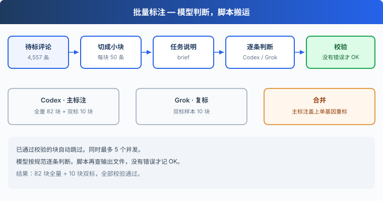
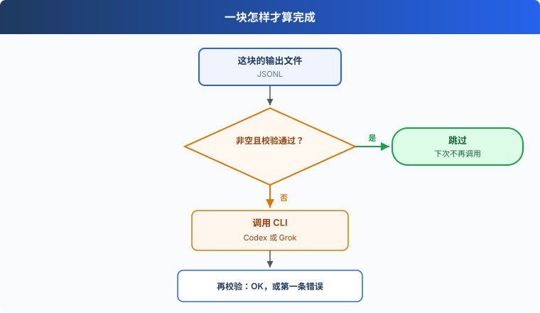

# s04: 批量标注 — 让 Coding Agent 按规范逐条判断

s01 → s02 → s03 → `s04` → [s05](../s05_agreement/) → s06
> *"判断交给模型，规则留在文件里"* — 规范、分块、校验，模型逐条读、脚本只管搬运。
>
> **方法层**：已打标数据集：4,557 条全量主标注。

---

## 问题

4,557 条评论可以标注了。你自己一条一条看，要看好几天。

把整份规范交给一个批量接口，模型推理慢，非流式调用还会超时。超时之后，这一批算不算做完，往往只看请求有没有返回。失败的那一批就这样混进后面的统计。

这一章把判断交给本机已登录的 Coding Agent。规范留在文件里，模型逐条读、逐条判断。脚本只管切块、发任务、校验，以及跳过已经通过的块。

## 解决方案





Codex CLI 做主标注，Grok CLI 做复标。复标只看到规范和原文。每 50 条一块，同时最多 5 个并发。已经校验通过的块直接跳过，中断了可以接着跑。

| 信号 | 含义 | 脚本做什么 |
|------|------|-----------|
| 没有输出，或文件是空的 | 这块还没写完 | 调用 CLI |
| 文件在，但校验有错误 | 写过，还不能用 | 再调用一次 |
| 校验没有错误 | 这块完成 | 打印跳过 |

每一块先生成一份任务说明。全量标注用 `brief.md`，只重标一个基因时用 `gene-brief.md`。说明要求模型逐条阅读、自己判断，不许另写脚本去调模型，也不许用关键词批量打标签。关键词能决定的，写进 `s03_product_genome/genome.md` 的判定规则，让两次标注用同一句话。

模型要自己把校验跑到 OK。日志里的 OK 以 `check_file` 为准：返回空列表，才打印 OK。

这批数据最后是 82 块全量、10 块双标，校验都通过了。

## 工作原理

分步来看。

**第 1 步**：评分先分成低、中、高三档，再按「应用 × 档」分层抽样，打乱后切块。

```python
def band(rating):
    return "low" if rating <= 2 else "mid" if rating == 3 else "high"


def sample(args, ap):

    rows = [r for r in map(json.loads, open(args.src, encoding="utf-8")) if not r["low_info"]]
    strata = defaultdict(list)
    for r in rows:
        strata[(r["app"], band(r["rating"]))].append(r)
    rng = random.Random(args.seed)
    sample = []
    for key in sorted(strata):
        group = strata[key]
        k = max(1, round(len(group) * args.ratio))
        sample += rng.sample(group, min(k, len(group)))
    rng.shuffle(sample)

    out = Path(args.out)
    (out / "chunks").mkdir(parents=True, exist_ok=True)
    keep = ("id", "app", "rating", "text")
    with (out / "sample.jsonl").open("w", encoding="utf-8") as f:
        for r in sample:
            f.write(json.dumps({k: r[k] for k in keep}, ensure_ascii=False) + "\n")
    for i in range(0, len(sample), args.chunk):
        with (out / "chunks" / f"chunk-{i // args.chunk:02d}.jsonl").open("w", encoding="utf-8") as f:
            for r in sample[i: i + args.chunk]:
                f.write(json.dumps({k: r[k] for k in keep}, ensure_ascii=False) + "\n")
    print(f"抽样 {len(sample)} 条（{len(strata)} 层），切成 {(len(sample) + args.chunk - 1) // args.chunk} 块")
```

1–2 星是低档，3 星是中档，4–5 星是高档。每一层至少留 1 条，所以很小的格子也不会被抽没。双标块的文件名是两位序号。

**第 2 步**：全量目录只放双标样本以外的评论，合并时再把两处的主标注接到一起。

```python
    done = {json.loads(l)["id"] for l in open(args.sample, encoding="utf-8")}
    rows = [r for r in map(json.loads, open(args.src, encoding="utf-8"))
            if not r["low_info"] and r["id"] not in done]
    out = Path(args.out) / "chunks"
    out.mkdir(parents=True, exist_ok=True)
    keep = ("id", "app", "rating", "text")
    for i in range(0, len(rows), args.chunk):
        with (out / f"chunk-{i // args.chunk:03d}.jsonl").open("w", encoding="utf-8") as f:
            for r in rows[i: i + args.chunk]:
                f.write(json.dumps({k: r[k] for k in keep}, ensure_ascii=False) + "\n")
    print(f"全量待标 {len(rows)} 条（已排除双标样本 {len(done)} 条），切成 {(len(rows) + args.chunk - 1) // args.chunk} 块")
```

全量块的文件名是三位序号。`low_info` 的评论在抽样和切块时都已经排除。

**第 3 步**：任务说明是一份模板。脚本只替换输入、输出和基因名，再按标注者拼出命令。

```python
    gene = os.environ.get("GENE", "")
    only = set(gene.split(",")) if gene else None
    template = Path(__file__).with_name("gene-brief.md" if gene else "brief.md").read_text(encoding="utf-8")
    codex = os.environ.get("CODEX_BIN") or "codex"
    grok = os.environ.get("GROK_BIN") or "grok"
    environment = {**os.environ, "DIR": str(directory), "CODEX_BIN": codex,
                   "GROK_BIN": grok, "GENE": gene, "PWD": str(root)}

    def task(who, src):
        number = src.stem
        tag = who + (f"-{gene}" if gene else "")
        out = directory / tag / f"{number}.jsonl"
        brief = directory / "briefs" / f"{tag}-{number}.md"
        log = directory / "logs" / f"{tag}-{number}.log"
        final = directory / "logs" / f"{tag}-{number}.final.md"
        text = template.replace("{IN}", str(src)).replace("{OUT}", str(out)).replace("{GENE}", gene)
        if who == "codex":
            command = [codex, "exec", "-C", str(root), "-s", "workspace-write", "-o", str(final), "-"]
            display = shlex.join(command) + " < " + shlex.quote(str(brief))
        else:
            command = [grok, "-p", text.rstrip("\n"), "--always-approve", "--cwd", str(root), "--disable-web-search"]
            # Display shell-equivalent brief expansion on one line, without dumping the prompt.
            display = shlex.quote(grok) + ' -p "$(cat ' + shlex.quote(str(brief)) + ')" --always-approve --cwd ' + shlex.quote(str(root)) + ' --disable-web-search'
```

Codex 从标准输入读这份说明。真跑时，Grok 的 `-p` 收到的是已经替换好的说明正文，并关掉网页搜索。`--dry-run` 把它打印成 `grok -p "$(cat 说明文件)"`，避免把整段提示词打出来，此时也不会调用 CLI。

**第 4 步**：一条标签合不合法，由 `genome.json` 决定。

```python
def check(raw, only=None):
    bad = []
    for g in GENOME["genes"]:
        if only and g["id"] not in only:
            continue
        v, t = raw.get(g["id"]), g["type"]
        if not only and raw.get("relevant") == "off_topic" and g["id"] != "relevant":
            continue
        if t in ("single", "rating"):
            ok = v in g["values"]
        elif t == "multi":
            ok = isinstance(v, list) and all(x in g["values"] for x in v) \
                 and bool(v or g.get("optional")) and len(v) <= g.get("max", 99)
            if ok and g.get("parent") and not only:
                ok = all(x.split(".")[0] in (raw.get(g["parent"]) or []) for x in v)
        else:
            ok = isinstance(v, str)
        if not ok:
            bad.append(f"{g['id']}={v!r}")
    return bad
```

单选必须命中取值。多选不能超出上限；空列表只有这个基因标了 `optional` 才合法。有父基因时，二级取值的前缀必须落在已选的一级下面。没有设置 `GENE` 时，跑题样本只查相关性。

**第 5 步**：一整块文件还要 id 对齐。输入有几条，输出就要有几条，而且每条都过第 4 步。

```python
def check_file(src, out, only=None):
    ids = [json.loads(l)["id"] for l in open(src, encoding="utf-8")]
    rows = [json.loads(l) for l in open(out, encoding="utf-8") if l.strip()]
    errors = []
    if sorted(r.get("id") for r in rows) != sorted(ids):
        errors.append(f"id 不对应：输入 {len(ids)} 条，输出 {len(rows)} 条")
    for r in rows:
        bad = check(r, only)
        if bad:
            errors.append(f"{r.get('id')}: " + ", ".join(bad))
    return errors
```

**第 6 步**：输出已经存在、而且 `check_file` 返回空列表，这块跳过。校验抛错，同样进入重跑。`--dry-run` 走到这里就打印命令并返回。

```python
        if out.is_file() and out.stat().st_size:
            try:
                if not check_file(src, out, only):
                    print(f"跳过 {who} {number}（已完成且校验通过）", flush=True)
                    return
            except Exception:
                pass  # 原 shell 的校验失败同样会重新运行。
        if args.dry_run:
            print(display + " > " + shlex.quote(str(log)) + " 2>&1")
```

**第 7 步**：真跑结束再查一次。没有输出文件，记为没能判定。有错误，日志里是第一条。没有错误，才是 OK。

```python
        verdict = "没能判定（未生成输出）"
        if out.is_file() and out.stat().st_size:
            try:
                errors = check_file(src, out, only)
                verdict = errors[0] if errors else "OK"
            except Exception as exc:
                verdict = f"{type(exc).__name__}: {exc}"
        print(f"{tag} {number} 用时 {int(time.time()) - start}s：{verdict}", flush=True)
```

**第 8 步**：每个标注者、每一块是一个任务。真跑时的并发数是命令里的 `jobs`。

```python
    tasks = [(who, src) for src in sorted((directory / "chunks").glob("*.jsonl"))
             for who in args.annotators.replace(",", " ").split()]
    if args.dry_run:
        for who, src in tasks:
            task(who, src)
    else:
        with ThreadPoolExecutor(max_workers=args.jobs) as pool:
            futures = [pool.submit(task, who, src) for who, src in tasks]
            for future in futures:
                future.result()
```

`--dry-run` 按顺序打印，不占用这组并发。

**第 9 步**：合并以主标注为底，把单基因重标按 id 盖回去。跑题样本不盖。

```python
            lab = {k: v for k, v in lab.items() if k != "id"}
            for g, rel in relabels.items():
                if lab.get("relevant") == "off_topic":
                    continue
                if rid in rel:
                    lab[g] = rel[rid][g]
                else:
                    stats[f"missing_relabel_{g}"] += 1
            if check(lab):
                stats["invalid"] += 1
            rec = {"id": rid, "app": r["app"], "rating": r["rating"], "date": r["date"], "text": r["text"],
                   "labels": lab, "annotator": args.main, "genome": GENOME["version"],
                   "in_double_sample": rid in review, "needs_review": review.get(rid, [])}
            stats["relevant" if lab.get("relevant") == "yes" else "off_topic"] += 1
            f.write(json.dumps(rec, ensure_ascii=False) + "\n")
```

盖完仍不合法的会计入 `invalid`，这一行还是写进输出，方便你对照。

<details>
<summary>子命令、默认参数与边界</summary>

| 子命令 | 作用 | 常用参数 |
|--------|------|----------|
| `sample` | 分层抽双标样本并切块 | `--ratio` 默认 0.1，`--chunk` 默认 50，`--seed` 默认 42 |
| `split` | 余下评论切成全量块 | `--chunk` 默认 50 |
| `run` | 并发调用已登录的 CLI | 目录、标注者、`jobs` 默认 5、`--dry-run` |
| `merge` | 合成最终标注 | `--main` 默认 `codex`，`--relabeled` 默认 `g17_risk` |

- `jobs` 小于 1，命令直接报错退出。
- 环境变量 `GENE` 非空时，模板换成 `gene-brief.md`，校验只查列出的基因，输出目录名带上基因。此时跑题样本也要给出这个基因。
- 输出文件长度为 0，不算完成。
- `--dry-run` 不创建 brief、不写日志、不调用 CLI。
- 合并时找不到主标注的 id 计入 `missing`，不写入输出。
- `CODEX_BIN` 和 `GROK_BIN` 用来换可执行文件名，不设就用 `codex` 和 `grok`。

</details>

## 试一下

**准备**（首次运行）：

```sh
pip install -r requirements.txt
```

`sample`、`split`、`merge` 和 `run --dry-run` 不读 `.env`。去掉 `--dry-run` 之后，`run` 会调用本机已登录的 `codex` 和 `grok`。

评论来自 s02 留下的 `data/clean/reviews.jsonl`。下面的命令都在仓库根目录运行。

**运行**：

```sh
python s04_labeling/code.py sample --ratio 0.1
python s04_labeling/code.py split --chunk 50
python s04_labeling/code.py run data/double codex,grok 5 --dry-run
```

可以试这三件事：

1. 把 `--ratio` 改成 `0.2` 再抽样，看打印出来的条数和块数；
2. `GENE=g17_risk python s04_labeling/code.py run data/double codex,grok 5 --dry-run`，看命令和说明文件名里出现这个基因；
3. 先读 `--dry-run` 的两行：一行是 `codex exec`，一行是 `grok -p "$(cat ...)"`。真跑之后打开对应日志，看模型是逐条写下标签，还是先写了一套关键词规则。

**观察重点**：`run --dry-run` 打印的命令；日志里模型是逐条给标签还是写了规则。

## 接下来

块都标完以后，同一条评论上会有两份标签。Codex 和 Grok 不会处处相同。

s05 双标一致性 → 两份标签对不上的时候听谁的？哪些基因的规则其实还说不清？
