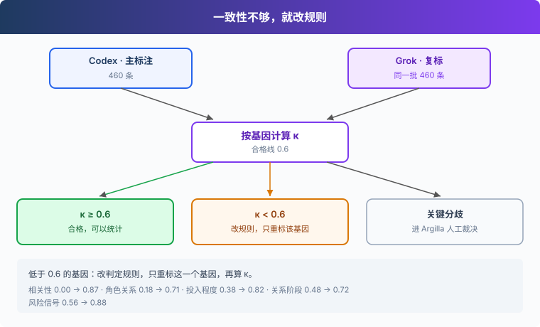
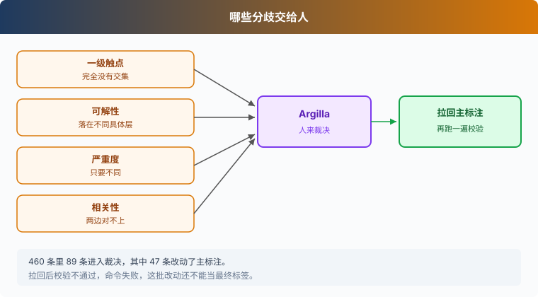

# s05: 双标一致性 — 两个模型标得不一样时听谁的

s01 → s02 → s03 → s04 → `s05` → [s06](../s06_product_definition/)
> *"一致性不够，就改规则，不改分数"* — 用 κ 找出说不清的基因，改规范、只重标、人工裁决。
>
> **方法层**：可信的标注：全部基因 κ ≥ 0.6。

---

## 问题

Codex 和 Grok 对同一批 460 条各标了一遍。并排放开，很多基因对不上。

删掉难标的样本，κ 会好看一些。规则哪里写糊了，还是不知道。全量 4,557 条，你没法每条都人工看过。

这一章用 κ 把说不清的基因找出来。规则改清楚，只重标那一个基因，再算一次。剩下的关键分歧交给人裁决。

## 解决方案





κ 按基因类型分开算。单选看两两 κ，多选把每个取值拆成「有没有」再平均，强度用加权 κ，两个分数离得越远，算得越不一致。文本基因 G13 不算 κ，只数写了「Agent 应当」的条数。

| κ | 报告里的判定 |
|---|--------------|
| ≥ 0.6 | 合格 |
| ≥ 0.4，且低于 0.6 | 需修订定义 |
| 低于 0.4 | 需重写定义 |
| 无法计算 | 没能判定 |

没能判定是输出缺失，或格式不合法。它不计入一致，也不计入不一致，单独报一个数。

第一次算出来，相关性 0.00、角色关系 0.18、投入程度 0.38、关系阶段 0.48。判定规则补进规范 v0.2.1 之后，这四个数是 0.87、0.71、0.82、0.72。风险信号 0.56，边界写进 v0.2.2，两边只重标这一个基因，κ 升到 0.88。

最终标注以主标注为准，全量才是同一套口径。进 Argilla 的只有关键分歧：一级触点完全没有交集，可解性落在两个不同的具体层，严重度只要不同就进，相关性对不上也进。在这批 460 条上，89 条进入裁决，其中 47 条改动了主标注。

拉回之后要再校验。裁决改了一级触点，改写前的二级触点可能对不上新的父级。校验不通过的条会标上 `review.invalid`。文件仍会写回，进程接着以非 0 退出。

## 工作原理

分步来看。

**第 1 步**：读入每一方的 JSONL。校验不通过的记录记成空，后面叫没能判定。

```python
def load(path, validate=True):
    p = Path(path)
    files = sorted(p.glob("*.jsonl")) if p.is_dir() else [p]
    out = {}
    for f in files:
        with f.open(encoding="utf-8") as source:
            for line in source:
                if not line.strip():
                    continue
                d = json.loads(line)
                labels = d.get("labels", d)  # prelabel 输出包在 labels 里，复标直接是字段
                if validate and check(labels):  # 不合法：整条记为没能判定
                    out[d["id"]] = None
                else:
                    out[d["id"]] = labels
    return out
```

路径是目录时，读入其中每个 `.jsonl`；同一 id 后读到的记录盖过先读到的。路径是单个文件时，就读这一个文件。

**第 2 步**：重标文件按 id 盖到一个基因上。`off_topic` 的样本不动。

```python
def apply_patch(annotations, gene, path):
    """按 id 叠加一个基因；同一补丁内重复 id 取最后一条，每个 id 只计一次。"""
    replacements = load(path, validate=False)
    if any(gene not in labels for labels in replacements.values()):
        raise ValueError("补丁记录缺少指定基因字段")
    applied = 0
    for rid, replacement in replacements.items():
        labels = annotations.get(rid)
        if labels is not None and labels.get("relevant") != "off_topic":
            labels[gene] = replacement[gene]
            applied += 1
    return applied
```

同一份补丁里 id 重复，取最后一条。每个 id 只计一次。

**第 3 步**：单选用 Cohen's κ。两个人碰巧都标进同一个大类时，期望一致率会把这份运气减掉。

```python
def cohen(a, b):
    n = len(a)
    if n == 0:
        return None
    po = sum(x == y for x, y in zip(a, b)) / n
    ca, cb = Counter(a), Counter(b)
    pe = sum(ca[k] * cb[k] for k in set(a) | set(b)) / (n * n)
    return 1.0 if pe == 1 else (po - pe) / (1 - pe)
```

**第 4 步**：强度是有序的。加权 κ 用距离做权重，`k` 取 3。

```python
def weighted(a, b, k=3):
    n = len(a)
    if n == 0:
        return None
    w = lambda x, y: 1 - abs(x - y) / (k - 1)
    po = sum(w(x, y) for x, y in zip(a, b)) / n
    ca, cb = Counter(a), Counter(b)
    pe = sum(ca[x] * cb[y] * w(x, y) for x in ca for y in cb) / (n * n)
    return 1.0 if pe == 1 else (po - pe) / (1 - pe)
```

**第 5 步**：按基因类型分发。文本只计数，单选和强度走上面两个函数，多选逐标签平均。

```python
    for gid, g in GENES.items():
        if g["type"] == "text":
            wrote = {n: sum("Agent 应当" in (ann[n][i].get(gid) or "") for i in rel) for n in names}
            report["genes"][gid] = {"agent_expectation_count": wrote}
            continue
        pool = ids if gid == "relevant" else rel
        if g["type"] in ("single", "rating"):
            cols = {n: [ann[n][i].get(gid) for i in pool] for n in names}
            pair = {f"{a}-{b}": r3(weighted(cols[a], cols[b]) if g["type"] == "rating" else cohen(cols[a], cols[b]))
                    for a, b in combinations(names, 2)}
            three = r3(fleiss([[cols[n][k] for n in names] for k in range(len(pool))], list(g["values"]))) \
                if len(names) >= 3 and g["type"] == "single" else None
            report["genes"][gid] = {"pairwise_kappa": pair, "fleiss_kappa": three}
        else:
            pair = {}
            for a, b in combinations(names, 2):
                ks = []
                for lab in g["values"]:
                    x = [lab in (ann[a][i].get(gid) or []) for i in pool]
                    y = [lab in (ann[b][i].get(gid) or []) for i in pool]
                    if any(x) or any(y):
                        ks.append(cohen(x, y))
                jac = [jaccard(ann[a][i].get(gid), ann[b][i].get(gid)) for i in pool]
                pair[f"{a}-{b}"] = {"mean_label_kappa": r3(sum(ks) / len(ks)) if ks else None,
                                    "mean_jaccard": r3(sum(jac) / len(jac)) if jac else None}
            report["genes"][gid] = {"pairwise": pair}
```

相关性用双方都有合法记录的全部样本。其余基因只用双方都标成相关的那些条。任何一个取值两边都没人标过，就不进平均。三方及以上、而且是单选时，`fleiss_kappa` 才有值；只有两方时这个字段是空。质量报告的判定列仍然按两两 κ，一对一对给。

**第 6 步**：主标注是 `--ann` 的第一个名字。四个关键基因按下面的条件写入 `needs_review`。

```python
    # 最终标注取主标注（第一个标注者）；只有关键基因分歧进入人工裁决（规则见 s05_agreement/protocol.md 第 5 节）
    main_name = names[0]
    merged = []
    for i in ids:
        main = ann[main_name][i]
        review = []
        if all(ann[n][i].get("relevant") == "yes" for n in names):
            # G5：主次不同但有交集算部分一致，只有完全没有交集才裁决
            sets = [set(ann[n][i].get("g5_touchpoint") or []) for n in names]
            if not set.intersection(*sets):
                review.append("g5_touchpoint")
            # G15："多层共同"与某一层不同属于部分一致，只有两个具体层不同才裁决
            vals = {ann[n][i].get("g15_solvable") for n in names}
            if len(vals) > 1 and "mixed" not in vals:
                review.append("g15_solvable")
            # G16：严重度决定优先级，任何不一致都裁决
            if len({ann[n][i].get("g16_severity") for n in names}) > 1:
                review.append("g16_severity")
        elif len({ann[n][i].get("relevant") for n in names}) > 1:
            review.append("relevant")
        merged.append({"id": i, "labels": main, "needs_review": review,
                       "raw": {n: ann[n][i] for n in names}})
    report["needs_review"] = sum(bool(m["needs_review"]) for m in merged)
```

可解性里如果有一方是「多层共同」（`mixed`），这处分歧不进裁决。一级触点只要还有交集，也不进。严重度没有这种部分一致。

**第 7 步**：质量报告把每个 κ 收成一档。

```python
def verdict(kappa):
    if kappa is None:
        return "没能判定"
    if kappa >= 0.6:
        return "合格"
    if kappa >= 0.4:
        return "需修订定义"
    return "需重写定义"
```

**第 8 步**：拉回的裁决写进主标注，然后整条再 `check`。不通过就记在 `review.invalid` 里。

```python
    covered = changed = invalid = 0
    for rec in final:
        d = decisions.get(rec["id"])
        if not d:
            continue
        before = rec["labels"]
        rec["labels"], notes = apply_decision(before, d, raw_by_id.get(rec["id"], {}))
        overwritten = ["relevant"] if d.get("relevant") == "off_topic" else list(d)
        overwritten.extend(k for k in dict.fromkeys([*before, *rec["labels"]])
                           if k not in overwritten and before.get(k) != rec["labels"].get(k))
        rec["review"] = {"decided": True, "before": {k: before.get(k) for k in overwritten},
                         "notes": notes}
        bad = check(rec["labels"])
        if bad:
            rec["review"]["invalid"] = bad
            invalid += 1
        covered += 1
        changed += before != rec["labels"]
    Path(args.final).write_text("".join(json.dumps(r, ensure_ascii=False) + "\n" for r in final), encoding="utf-8")
    print(f"拉回 {len(decisions)} 条裁决；已覆盖条数：{covered}；改动主标注条数：{changed}；"
          f"校验不通过条数：{invalid}；已更新 {args.final}")
    if invalid:
        raise SystemExit(1)
```

文件先写回，再在有不通过的条时以状态 1 退出。`changed` 只看这条的标签有没有变，一条样本计一次。

<details>
<summary>补丁、空集合与命令</summary>

盖完所有补丁之后才统一校验。重标可以修好校验不通过的字段；修不好的整条变成没能判定。

```python
    # 所有补丁叠加后再校验，允许重标修复原先不合法的基因。
    for annotations in ann.values():
        for rid, labels in annotations.items():
            if check(labels):
                annotations[rid] = None
```

多选的 Jaccard：两边都是空，算一致。

```python
def jaccard(x, y):
    x, y = set(x or []), set(y or [])
    return 1.0 if not x and not y else len(x & y) / len(x | y)  # 两方都为空算一致

```

| 子命令 | 作用 |
|--------|------|
| `agree` | 算 κ，写 `agreement.json` 和 `merged.jsonl` |
| `quality` | 把 κ 收成判定档位 |
| `review push` | 把 `needs_review` 的样本推进 Argilla |
| `review pull` | 拉回裁决，改主标注，再校验 |
| `import` | 把评论导入 Argilla，供人工逐条标注 |

- `--patch` 的格式是 `名字:基因=路径`，路径可以是一个 JSONL，也可以是一目录的 `.jsonl`。
- 补丁里缺这个基因字段，命令拒绝整份补丁。
- 写进 JSON 的 κ 保留三位小数。算不出来是 `null`，报告里显示没能判定。
- `ARGILLA_API_URL` 默认 `http://localhost:6900`。`review` 和 `import` 还要有 `ARGILLA_API_KEY`。
- 裁决把一条从跑题改成相关时，会借用另一位标注者的完整标签来补空，再套用本次裁决。补完仍不合法，会在 `notes` 里记下 `incomplete`。

</details>

## 试一下

**准备**（首次运行）：

```sh
pip install -r requirements.txt
```

`agree` 和 `quality` 只读本地文件。要把分歧推进 Argilla，或把裁决拉回来，先复制 `.env.example` 为 `.env`，把 `ARGILLA_API_KEY`、`ARGILLA_USERNAME`、`ARGILLA_PASSWORD` 换成你的配置，再在当前 shell 里加载。Python 读的是环境变量。

```sh
cp .env.example .env
# 编辑 .env，替换 Argilla 的占位值，然后：
set -a && source .env && set +a
docker compose -f s05_agreement/docker-compose.yaml up
```

标注目录来自 s04。下面的命令都在仓库根目录运行。`--ann` 的第一个名字是主标注。

**运行**：

```sh
python s05_agreement/code.py agree --ann codex=data/double/codex --ann grok=data/double/grok
python s05_agreement/code.py quality
```

`quality` 还要读 s04 `merge` 写出的 `data/labeled/genome-final.jsonl`，用来统计裁决改了多少条。

可以试这三件事：

1. 加上单基因重标再算一次。这两个目录是 `GENE=g17_risk` 时对 `data/double` 跑 `run` 写下的：`--patch codex:g17_risk=data/double/codex-g17_risk --patch grok:g17_risk=data/double/grok-g17_risk`，看风险信号这一列；
2. 打开 `data/reports/quality-report.md`，看每个基因是「合格」「需修订定义」还是「需重写定义」；
3. 人在 Argilla 提交之后运行 `python s05_agreement/code.py review pull`，看打印出来的校验不通过条数。大于 0 时进程以状态 1 退出。

**观察重点**：`quality` 报告里每个基因的判定档位；裁决拉回后为什么必须重新校验。

## 接下来

κ 过了线，只说明这个基因的规则两个人标得动。它还不告诉你产品该先做什么。

s06 从标签到产品定义 → 分布、切片、行为主题，怎么收成一句句能指回样本的定义？
