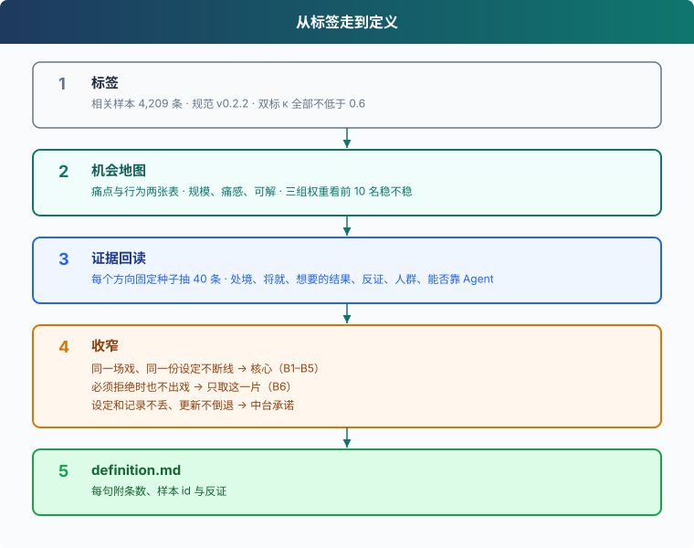

# s06: 从标签到产品定义 — 让每条结论带着条数、样本和反证

s01 → s02 → s03 → s04 → s05 → `s06`
> *"定义里的每一句都能指回样本"* — 机会地图排优先级，逐条回读找反证，再收窄成定义。
>
> **方法层**：产品定义 v1，每条结论附条数、样本 id 与反证。

---

## 问题

标签已经齐了。4,209 条相关样本，规范 v0.2.2，双标的 κ 全部不低于 0.6。你要写的是「做什么」。

最容易走偏的一步，是心里先有一个产品，再从报告里把支持它的数字挑出来。这一章的第一版定义就这么写过：能叫出名字的人群里，陪伴向最大，708 条，占相关样本 16.8%，于是写成了首要用户。

同一份切片里，这 708 条有 365 条严重度是「无问题」，占 51.6%。他们没有提出问题。剧情玩家只有 216 条，P0+P1 有 131 条，占 60.6%。人多的那一群，一半在说还好；更高的痛感比例在更小的一群里。数字在 `data/reports/segment-report.md`，比例的分母是这一片自己的人数。

第一版看见了这 51.6%，仍把陪伴向留成首要用户，理由是他们已经在用，离开是因为角色变了。后面的行为清单就跟着这 708 条筛。满意的人和疼的人被当成了同一群人。

这一章先给痛点和行为打分，再按固定种子把三个方向各读 40 条，最后只把经得起反证和集中度检查的句子写进定义。

## 解决方案



按人数排，陪伴向会排在前面。按「条数乘痛感，再看像不像已经选定的首要用户」来留行为，筛子仍是那 708 条。机会地图把规模放进对数，和痛感、可解乘在一起，再用另外两组权重各排一次。三组名次里只要有一组掉出前 10，这一行就不算稳定。

排完还不够。标签会把好评和别的问题圈进同一个池。所以每个候选方向都抽原文，逐条写处境、用户现在怎么将就、真正想要的结果、这条例子算不算反证。

| 步骤 | 它检查什么 | 留下什么 |
|------|------------|----------|
| 机会地图 | 规模、痛感、可解；换三组权重，名次还在不在前 10 | 痛点、行为两张表上站得住的候选 |
| 证据回读 | 标签圈进来的是不是这件事 | 处境、将就、想要的结果、反证 |
| 收窄 | 几件事是不是同一个产品；痛是不是集中在一两家 | 核心、只取的一片、中台承诺 |

## 机会地图：两种粒度，三组权重

`opportunities` 出两张表。痛点表的一行是一个二级触点，比如「日常对话被误拦」。行为表的一行是一个「Agent 应当」主题，比如「守住人设」。同一样本在同一个候选里只计一次。少于 15 条的候选不进排名。

每一行三个数相乘：规模、痛感、可解。规模是 `log(1+n) / log(1+这张表里的最大 n)`，所以 400 条不会仅仅因为条数多就压过 30 条。痛感把 P0+P1 比例、情绪强度、流失、老用户对比从前合成一个 0 到 1 的数。可解取「Agent 或混合」与「平台或混合」里更高的那个；只被标成商业问题的，可解上不去。

默认权重是 `(1, 1, 1)`。脚本同时用固定的另外两组再排：规模减轻 `(0.5, 1, 1)`，痛感加重 `(1, 1.5, 1)`。一个候选三组名次都在前 10，才标成稳定。在这批数据上，痛点表和行为表的默认前 10 名里，各有 9 个稳定。痛点里掉出去的是 `persona.setting_ignored`（关系或背景设定被无视，名次 10 / 11 / 11）。行为里掉出去的是 `sound_human`（像活人说话，名次 10 / 12 / 11）。

默认权重下，痛点第 1 名是日常对话被误拦（`moderation.false_positive`，274 条，P0+P1 89%），第 2 名是自己的数据丢失（`reliability.data_lost`，105 条，P0+P1 98%）。广告（`monetization.ads`）有 410 条，是痛点里最大的一堆，名次第 32：P0+P1 只有 56%，可解约 0.51，很多被标成商业问题。

行为前 6 名是守住人设、不复读、听懂这一句、上下文接得上、记住已发生的事、多角色可辨。记住已发生的事有 230 条，是行为里最大的一堆，名次第 5。守住人设 163 条，名次第 1。条数最大的，没有自动当核心。

换模型（`lifecycle.model_change`）只有 29 条，痛感约 0.81，默认名次第 9；规模权重降到 0.5 时升到第 3。它仍在三组的前 10 里，算稳定。小而疼的候选会被另外两组权重抬上来，抬不进前 10 的就留在表的后部。

这些名次都可以用本章命令从 `data/labeled/genome-final.jsonl` 和 `data/labeled/agent-themes.jsonl` 再跑一遍，报告在 `data/reports/opportunity-map.md`。

## 证据回读：每个方向读 40 条

地图给出排序，不告诉你标签有没有圈错人。回读拿三个方向做候选，每个方向把池里的样本 id 排序，用种子 11 抽 40 条，逐条读原文。评论原句不进定义，例子用改写，附样本 id。基因标签只用来圈池。人群、反证、能不能靠 Agent 解决，都按原文重判。

三个池的大小是 H1 670、H2 1,041、H3 306。池子规则、种子和 Python 版本放在下面的工作原理里。抽出来之后按同一张记录卡填。

| 方向 | 结论 | 反证 | 能靠 Agent 解决 | 为什么没选 / 怎么用 |
|------|------|------|-----------------|---------------------|
| H1 长线剧情不崩 | 部分成立 | 17/40 | 11/40 | 症状真实且跨产品；但「聊久了才崩」只有 3/40，剧情玩家只有 8/40——**收窄**为「同一场戏、同一份设定不断线」，作为本产品的核心 |
| H2 升级不倒退 | 部分成立 | 17/40 | 4/40 | 是几件事捆在一起：数据丢失（有画像的样本里创作向最多，靠存储与迁移）+ 广告、次数、违禁词。取其中「用户的设定和记录不丢、更新前后不倒退」作为**中台承诺** |
| H3 不误伤的对话边界 | 成立 | 4/40 | 7/40 | 证据最站得住，但全量 274 条里 86% 来自两家产品的关键词表，主要靠审核策略解决，又碰到本课不覆盖的合规。只取 Agent 能做的部分：**必须拒绝时角色自己接住，不念固定句式、不插说教** |

H1 的 40 条里，明确写了聊很久才坏的只有 3 条。更常见的是日常短聊就接不上，例如两三句就对不上（as-05dc30bb0355）。17 条不能支持这个方向：有的是好评被痛点标签圈进来（as-bf84263ead51），有的主诉根本是别的问题。能看出来的人群里，剧情玩家 8、陪伴向 8、创作向 6，看不出这些画像的 22（可以重叠）。

H2 的池子把「老用户」也放了进去。40 条里有 13 条只有这个条件，其中 11 条落在反证里。去掉这 13 条，反证大约 6/27。剩下的支持样本仍是好几件事：手写的群聊和记录没了（as-9a41e2bb7016），和模型下架后变笨（as-eed2bd41c118），不是同一件事。变笨只有个别几条。能靠改回复解决的是 4/40。

H3 的 40 条里，36 条就是日常句子发不出，或对话被「换个话题」和说教打断。反证 4/40。能靠 Agent 的说法解决的是 7/40，例如聊到一半突然被建议换话题（as-221a1a103dd1）。其余大多是发送前就被拦住，回复写得再好也过不了那道墙。

## 收窄：什么留下，什么拆开

**被推翻的判断。** 回读前把 H1 和 H2 看成一件事的两面：更新后变差，就是一致性变差。回读之后这句不成立，H1 和 H2 不是一件事。H2 里真正疼的是创作内容丢失，换模型变笨只有个别几条。两边的人群和根因都不同，所以没有合成一个产品。

留下的是三句，互相不替代：

- H1 收窄成「同一场戏、同一份设定不断线」，作为核心。展开成 B1 到 B5。
- H3 只取「拒绝不出戏」。必须拒绝时，由角色把话接住，不念固定句式，不插说教。这是 B6。
- H2 只取「用户的设定和记录不丢、更新前后不倒退」，作为中台承诺。丢数据是 105 条，P0+P1 98%，分布在 9 个应用里。更新不倒退的做法是：换模型或改提示词之前，用同一套评测集回归，B1–B6 的通过率不得下降。

**集中度。** 误拦的证据最齐，却集中在两家产品的关键词表。全量 274 条里，筑梦岛 140 条、星野 95 条，合计 235 条，约 86%。回读的 40 条里有 32 条来自这两家。新做的 Agent 若不抄这两份词表，这 86% 不会自动变成上线第一天的问题。场景连续铺得开：B1–B6 对应主题的并集 522 条，分布在 10 个应用里，前两家只占 47%。定义因此把核心放在收窄后的 H1，从 H3 只拿走 Agent 做得到的那一片。

为谁：已经写好人设和关系、要和角色把这场戏接着演的人。他们散在剧情玩家、陪伴向、创作向，以及看不出画像的评论里。这不是某一类人独有的问题。

主题条数是规模的上限。H1 的标签池里约四成不是这场失败（回读 17/40）。下表的「主题证据」是命中样本 / 其中 P0+P1 / 涉及应用数。完整句子、反证和局限在 [definition.md](definition.md)。

| 编号 | 行为 | 主题证据 | 一条样本（改写） |
|------|------|----------|------------------|
| B1 | 记住这场戏：地点、关系、刚做过的事 | 314 / 265 / 9 个应用 | 两三句就接不上（as-05dc30bb0355） |
| B2 | 设定当设定：括号和人设栏是舞台指示 | 45 / 36 / 8 | 年龄差、性格标签被当面念出（as-09f348f05ac5） |
| B3 | 角色不串：几个人、日常和剧情不合成一个 | 49 / 45 / 7 | 几个角色合成一个，地点从家里跳走（as-edc43c27677a、as-7265b403f9a0） |
| B4 | 关系不擅改：写好的冷淡、分寸、非恋爱不漂移 | 188 / 154 / 9 | 写了冷淡和分寸仍被冒犯（as-44d905f0dea7） |
| B5 | 剧情不被掐断：不插无关事件，不用一句换话题结束 | 44 / 35 / 7 | 按剧情选项走仍被要求换话题（as-c6af68379204） |
| B6 | 拒绝不出戏：必须拒绝时由角色接住 | 52 / 48 / 5 | 聊得正好突然被建议换话题（as-221a1a103dd1） |

不做的部分：审核政策本身、定价与广告、创作广场与 UGC 工具、存储迁移之外的运营问题。

## 工作原理

分步来看。分布和切片只留后面打分要用的两步。打分在 `opportunities`。回读没有对应的子命令，用记录卡。

**第 1 步**：分布只统计 `relevant` 为 `yes` 的样本。后面所有占比，凡是写「占相关样本」的，分母都是这个数。这批数据上它是 4,209。

```python
    allrows = [json.loads(l) for l in open(args.src, encoding="utf-8")]
    rows = [r for r in allrows if r["labels"].get("relevant") == "yes"]
    n = len(rows)
```

**第 2 步**：切片先按画像归人，再在这一片里面数 P0+P1。陪伴向按画像或动机圈人，圈的时候不管这一片最后有多少条。剧情玩家的 60.6% 就是这里的 `p0_p1 / count`。

```python
        users = values(labels, "g1_user")
        motives = values(labels, "g2_motive")
        memberships = users.intersection(SEGMENTS)
        if users.intersection({"dream_partner", "confider"}) or motives.intersection(
            {"companionship", "emotional_support", "romance"}
        ):
            memberships.add("陪伴向")
        if "creator" in users or "creation" in motives:
            memberships.add("创作向")
        expected = labels.get("g13_expected")
        agent = isinstance(expected, str) and "Agent 应当" in expected
        severe = labels.get("g16_severity") in ("p0", "p1")
        counts = {gid: values(labels, gid) for gid in REPORT_GENES}
        for key in memberships:
            segment = segments[key]
            segment["count"] += 1
            segment["agent"] += agent
            segment["p0_p1"] += severe
```

画像里有 `dream_partner` 或 `confider`，或者动机里有 `companionship`、`emotional_support`、`romance`，就进入陪伴向。一条样本可以同时进好几片。`unknown` 不单独成片。陪伴向的 708 条按这几条规则圈出来；圈进去之后再数严重度，365 条是「无问题」。

**第 3 步**：机会分成两张表。痛点用二级触点，以 `.other` 结尾的键不进表。行为用主题文件里的主题，一个样本多句命中同一主题只算一次。

```python
        for key in values(labels, "g6_subtouch"):
            if key.endswith(".other"):
                excluded_other.add(key)
            else:
                pain_groups[key].append(labels)
```

```python
    behavior_groups = defaultdict(list)
    for sample_id, themes in themes_by_id.items():
        for theme in themes:
            behavior_groups[theme].append(relevant[sample_id])
```

**第 4 步**：痛感 `severity` 和可解 `solvable` 在每个候选内部算，分母是这个候选自己的命中样本数。

```python
    def share(gid, accepted):
        return sum(label.get(gid) in accepted for label in labels) / n

    result = {
        "candidate": key, "n": n,
        "pain": share("g16_severity", ("p0", "p1")),
        "intensity": sum(intensities) / len(intensities) if intensities else None,
        "intensity_n": len(intensities),
        "churn": share("g10_stage", ("churning",)),
        "regress": share("g10_stage", ("veteran",)),
        "agent_share": share("g15_solvable", ("agent", "mixed")),
        "platform_share": share("g15_solvable", ("platform", "mixed")),
        "business_share": share("g15_solvable", ("business",)),
        "paying": share("g4_investment", ("paying",)),
        "segments": {segment: segments[segment] for segment in OPPORTUNITY_SEGMENTS},
    }
    intensity_term = (result["intensity"] - 1) / 2 if intensities else 0
    result["severity"] = (0.5 * result["pain"] + 0.2 * intensity_term
                          + 0.15 * result["churn"] + 0.15 * result["regress"])
    result["solvable"] = max(result["agent_share"], result["platform_share"])
```

`pain` 是严重度为 P0 或 P1 的占比。`churn` 是关系阶段为流失的占比。`regress` 这个名字容易看成回归，代码里它是阶段为 veteran（老用户对比从前）的占比。强度用 `g8_intensity` 的均值，按 `(强度 - 1) / 2` 压到 0 和 1 之间；一个候选全都没有强度时，这一项贡献 0。四项的权重是 0.5、0.2、0.15、0.15。

`solvable` 取 Agent 份额和平台份额的较大值。`mixed` 两边都算，取最大之后只留下一次。只标成 `business` 的样本不抬高可解。付费占比会写进表，不进入这两个数。

**第 5 步**：分数是三项的幂次积。命令行传来的权重是主排序 `default`。另外两组权重固定，用来看名次敏不敏感。

```python
    variants = {"default": list(weights), "size_light": [0.5, 1, 1],
                "pain_heavy": [1, 1.5, 1]}
```

```python
def rank_opportunities(groups, min_n, weights):
    rows = [opportunity_metrics(key, labels) for key, labels in groups.items()
            if len(labels) >= min_n]
    max_n = max((row["n"] for row in rows), default=0)
    for row in rows:
        row["size"] = math.log1p(row["n"]) / math.log1p(max_n)
        row["scores"] = {
            variant: row["size"] ** w1 * row["severity"] ** w2 * row["solvable"] ** w3
            for variant, (w1, w2, w3) in weights.items()
        }
        row["score"] = row["scores"]["default"]
        row["ranks"] = {}
    for variant in weights:
        ordered = sorted(rows, key=lambda row: (-row["scores"][variant], row["candidate"]))
        for rank, row in enumerate(ordered, 1):
            row["ranks"][variant] = rank
    rows.sort(key=lambda row: row["ranks"]["default"])
    for row in rows:
        row["stable"] = all(rank <= 10 for rank in row["ranks"].values())
```

`size` 在每一张已经过滤过的表里单独归一。分数是 `size^w1 * severity^w2 * solvable^w3`。同一组里分数相同，按候选键的字典序排，输出不跟着样本顺序晃。`stable` 要求三组名次都小于等于 10。默认前 10 名之外的候选，默认名次已经大于 10，不会被标成稳定。所以「前 10 名里有 9 个稳定」，就是这两张表上各有一个第 10 名没有同时待在另外两组的前 10 里。

**回读记录卡**

回读不在 `code.py` 里。每个方向 40 条，一条一张卡，先写完再汇总反证比例。

| 字段 | 写什么 |
|------|--------|
| 样本 id | 可回查。正文只留改写，不抄评论原句 |
| 处境 | 日常、长对话、更新或迁移之后，还是别的场合。原文没写时长，就不补成「聊久了」 |
| 将就方式 | 用户现在怎么绕。没写就记没有 |
| 真正想要的结果 | 希望哪件事变成什么样 |
| 反证 | 这条例子能不能支持该方向。好评被标签圈进来、主诉其实是别的问题，都算反证 |
| 人群 | 按原文重判，可以重叠：剧情玩家、陪伴向、创作向、进阶玩家、其他。标签不代替这一格 |
| 能否靠 Agent 解决 | 主诉靠记忆、人设、说话方式或拒绝方式就能明显好转，才算能。发送前拦截、记录丢失、按钮下线、广告和定价，不算。两层缠在一起、只改说法不够的，也不算 |

按这张卡，as-05dc30bb0355 的处境是两三句就接不上，没有写成聊了很久；没有写出将就办法；想要的是这场戏还接得上；这条算支持；画像落在「其他」；主诉落在 Agent 做得到的那一层。

<details>
<summary>权重、过滤与回读抽样</summary>

- 主排序的 `(w1, w2, w3)` 来自命令行，默认 `(1, 1, 1)`，写进变体 `default`。`--w1 --w2 --w3` 只改这一组。
- `size_light` 固定 `(0.5, 1, 1)`，`pain_heavy` 固定 `(1, 1.5, 1)`。
- 权重写成 0 时，对应因子的指数是 0。正数的 0 次方是 1，这一项不再拉开名次。
- `min-n` 默认 15。痛点里以 `.other` 结尾的键整组排除，不占这个名额。这批数据上，痛点候选 59 个，滤掉 7 个，另排除 12 个 `.other`；行为候选 24 个，滤掉 2 个。
- 强度缺失的样本不进均值。商业占比和付费占比只出现在表里。
- 回读的三个池，相关样本取下面这些信号的并集。H1：主题 `remember_facts`、`stay_coherent`、`hold_persona`、`differentiate_roles`、`protect_user_voice`、`advance_plot`，或痛点 `memory.*`（含 `memory.other`）、`persona.ooc`、`persona.setting_ignored`、`dialogue.irrelevant`。共 670 条。
- H2：`lifecycle.model_change`、`lifecycle.feature_removed`、`reliability.data_lost`，或触发里有 `after_update`，或阶段是 `veteran`。共 1,041 条，其中 353 条只有 `veteran`。
- H3：`moderation.false_positive`、`moderation.deflection`，或主题 `dont_false_refuse`。共 306 条。
- 抽样：候选 id 排序后，用种子 11 各取 40 条。本次回读的解释器是 Python 3.14.6。别的版本抽到的 40 条可能不同。两个方向抽中同一条的只有 as-ffd9d05d17e2、as-ee2592db1e48。

</details>

## 试一下

**准备**（首次运行）：

```sh
pip install -r requirements.txt
```

这一章不读 `.env`。输入是 s05 裁决拉回之后的 `data/labeled/genome-final.jsonl`，以及行为主题 `data/labeled/agent-themes.jsonl`。下面的命令都在仓库根目录运行。

**运行**：

```sh
python s06_product_definition/code.py genome-report --src data/labeled/genome-final.jsonl
python s06_product_definition/code.py segment-report --src data/labeled/genome-final.jsonl
python s06_product_definition/code.py opportunities --min-n 15 --w1 1 --w2 1 --w3 1
```

可以试这三件事：

1. 换主排序的权重再跑一次，例如 `--w1 0 --w2 1 --w3 1 --out data/reports/opportunity-w1-0.md`。对照默认报告里每个候选的三列名次，看前 10 名和「稳定」列变了没有。`--w1 --w2 --w3` 只改 `default` 这一组。
2. 把 `--min-n` 调到 30。`lifecycle.model_change` 只有 29 条，看它还在不在痛点表里。这是门槛在变，不是权重在变。
3. 回读自己抽一次。先按工作原理里的规则凑出一个方向的候选 id，排序后：

```python
import random
picked = random.Random(11).sample(sorted(candidate_ids), 40)
```

对抽到的 id 填记录卡。Python 版本和 3.14.6 不同时，这 40 个 id 可以和本章用过的不一样。

打开 `data/reports/segment-report.md` 的切片对比，陪伴向的「无问题」和剧情玩家的 P0+P1 可以对上 51.6% 和 60.6%。

**观察重点**：换权重后前 10 名变不变；每个方向的反证比例；一个机会是不是集中在一两家产品。

## 接下来

B1 到 B6 已经能指回条数、样本 id 和反证。另一个人还不能拿着这六条直接做，也没有一套可以重复跑的测试。

s07 → 这六条怎样写成一份别人能照着做、照着测的 PRD？
